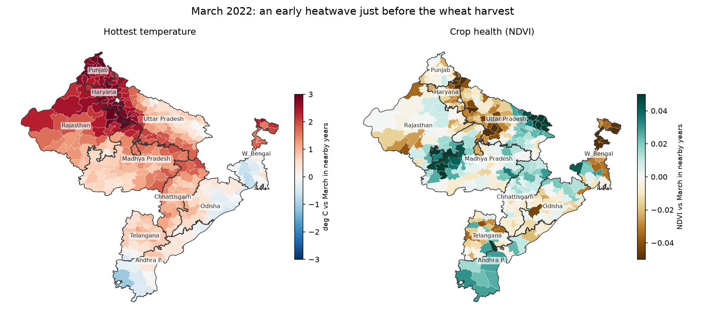
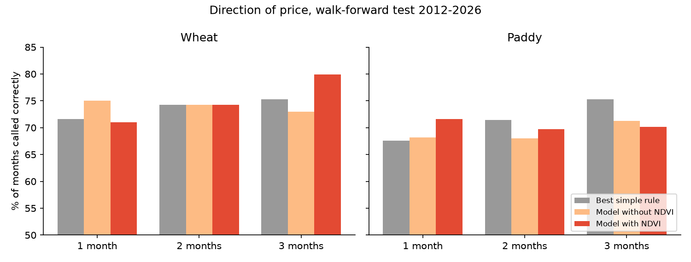

# AgriSignal

**Live dashboard: [agrisignal.streamlit.app](https://agrisignal.streamlit.app/)**

Can satellite pictures of crops predict where Indian grain prices go next? AgriSignal measures crop health from space in 329 districts across India's main wheat and rice states, combines it with weather and government data, and tests whether that helps predict if all-India wheat and paddy prices will rise over the next 1 to 3 months.



*March 2022, just before the wheat harvest: an early heatwave pushed the hottest temperatures up to 3 degrees above nearby years across Punjab, Haryana, Rajasthan and western Uttar Pradesh (left). The crops browned most in Haryana and western Uttar Pradesh (right). The heat mostly shrank the grain rather than browning the leaves, so the damage looks milder from space than it was in the fields. Wheat prices rose 3.2% that month, and wheat exports were banned in May.*

## What I found

- **Crop health predicts wheat prices.** When the wheat states are greener than in recent years, wheat prices rise less over the following months. This passes a Granger causality test at 1, 2 and 3 month lags, even after correcting for running 48 tests.
- **It improves the 3-month wheat forecast.** In a walk-forward test on 2012 to 2026, adding NDVI raises accuracy from 73.0% to 79.9%, against 75.3% for the best simple rule (the usual direction for that calendar month). Only the models with NDVI give better probability forecasts than that rule (Brier score 0.150 vs 0.173, p = 0.016).
- **The edge is real but modest.** The accuracy gain over the calendar rule (+4.6 points over 174 months) is not statistically significant on its own (McNemar p = 0.24), and it varies from year to year.
- **Paddy is different.** Paddy prices rise almost every year, and no model beats simply predicting "up". Crop conditions add nothing measurable; government buying at the minimum support price seems to matter more.
- **More data killed a false lead.** On 2018 to 2026 data, rainfall looked as useful as NDVI for paddy. With 21 years of data the effect disappears.



The full write-up is in [reports/report.md](reports/report.md).

## How it works

1. **Satellite and weather data.** Monthly crop health (NDVI from NASA's MODIS Terra and Aqua satellites, cropland only, cloudy pixels removed), rainfall (CHIRPS) and temperature (ERA5-Land) for every district, extracted with Google Earth Engine.
2. **Prices and policy.** All-India wholesale price indices for wheat and paddy (three official series joined into one), plus overall and food inflation, diesel prices, government grain stocks, minimum support prices, and the dates of export bans and stock limits.
3. **Cleaning and a database.** Non-farm districts are dropped, unreliable values are filled and flagged, and everything is loaded into a SQLite database through SQLAlchemy.
4. **Exploration.** One national series per crop, weighting each district by its farmland, and a look at which signals move with later prices (`notebooks/01_eda.ipynb`).
5. **Signal tests.** Leakage-free features, simple baseline rules and Granger causality tests (`notebooks/02_signal_tests.ipynb`).
6. **Models.** Logistic regression and XGBoost, retrained every month on past data only and scored against the baselines (`notebooks/03_models.ipynb`).
7. **Dashboard.** A Streamlit app with a district crop health map, prices next to each signal, and the latest forecast with the models' track record.

## Data

| Data | Source | Coverage |
|---|---|---|
| Crop health (NDVI) | NASA MODIS Terra and Aqua (MOD13Q1, MYD13Q1) via Google Earth Engine, cropland only (ESA WorldCover) | 329 districts in 10 states, monthly |
| Rainfall | CHIRPS v3 daily rainfall, summed per month | Same districts, monthly |
| Temperature | ERA5-Land monthly mean and hottest air temperature | Same districts, monthly |
| Prices | Wholesale Price Index for wheat, paddy, all commodities, food articles and diesel, Office of the Economic Adviser | All-India, monthly |
| Government grain stocks | Central pool wheat and rice stocks on the 1st of each month, Foodgrains Bulletins of the Department of Food and Public Distribution | All-India, monthly |
| Minimum support price | MSP plus any bonus for each marketing season, same department | All-India, yearly |
| Policy events | Export bans and stock limits, from DGFT notifications, PIB releases and Lok Sabha answers (sources in the file) | Dated events |

Everything covers January 2005 to September 2026. District boundaries come from FAO GAUL 2025.

A few things needed extra work:

- **Prices.** The WPI was published with three base years (2004-05, 2011-12 and 2022-23). I chain-linked them item by item, so every real monthly move is kept. My linking factor for all commodities (1.526) matches the official one (1.53). Before April 2012 there is no paddy index, so the rice index stands in (marked in the data).
- **Grain stocks.** No free monthly series exists, so I built one from the Department of Food and Public Distribution's monthly bulletins. Six text bulletins cover 2012 to 2026; their 57 overlapping months match exactly. 2005 to 2011 only survives as a scanned bulletin (Internet Archive copy of the old dfpd.nic.in site), so I typed that table into `data/raw/fci_stocks_transcribed.csv` and checked every month against the printed totals and a second bulletin. The checks also caught one misprint in an official bulletin.
- **Temperature.** I first used MODIS land surface temperature, but both satellites' orbits have drifted since about 2020, so they pass over later or earlier in the day and read 2 to 3 degrees cooler in 2025 and 2026. ERA5-Land has no such drift and still picks out the real heatwaves (March 2010, 2017 and 2022).

## Project structure

```
src/                  data pipeline, features, models and figures
  extract_*.py        satellite and weather data from Earth Engine
  build_wpi.py        linked price series
  build_fci_stocks.py grain stocks from the bulletins
  clean_data.py       cleaning
  build_database.py   SQL database
  build_national.py   national monthly table per crop
  build_features.py   leakage-free model features
  baselines.py        simple rules the models must beat
  train_models.py     walk-forward model testing
  forecast.py         forecast from the latest data
sql/schema.sql        database schema
notebooks/            exploration, signal tests and model results
dashboard/            Streamlit app
data/raw/             extracted and collected data
data/processed/       cleaned data, features and predictions
reports/              report and figures
tests/                unit tests
```

## Running it

```
python -m venv .venv
.venv\Scripts\activate
pip install -r requirements-dev.txt
```

To only look at the results, the dashboard needs nothing else, because it reads the committed data:

```
streamlit run dashboard/Overview.py
```

To rebuild everything, copy `.env.example` to `.env`, add your Google Earth Engine project id, and run `earthengine authenticate`. Then:

```
python src/extract_ndvi.py
python src/extract_rainfall.py
python src/extract_temperature.py
python src/build_wpi.py
python src/build_fci_stocks.py
python src/clean_data.py
python src/build_database.py
python src/build_national.py
python src/build_features.py
python src/train_models.py
python src/forecast.py
python src/export_districts.py
python src/make_figures.py
```

The NDVI extraction takes a few hours and saves one file per state, so if it stops halfway, running it again continues where it left off. The price and bulletin sites sometimes send an incomplete security certificate, which Python rejects; if a download fails, the script prints the link so the file can be saved by hand.

Tests: `pytest tests`

## Limitations

- About 225 months of usable data is not much for a model. The results are stated with that in mind.
- Fog and monsoon cloud leave a few district-months with too few clear pixels; these are filled from the months either side and flagged.
- NDVI does not separate crops: in the kharif season it includes cotton and soybean as well as rice.
- NDVI drifts slightly upward over the years. The model features compare each month with only the previous five years, which absorbs most of this. The maps and charts compare each month with the five years either side instead, which also uses later years, so they are for looking at the data, not for prediction.
- Before April 2012 the paddy price is the rice index, and the latest one or two months of WPI are provisional.
- Government stocks, support prices and export bans partly react to prices, so their links with prices run both ways.

## Tools

Python, pandas, Google Earth Engine, SQLite with SQLAlchemy, statsmodels, scikit-learn, XGBoost, Plotly, Streamlit, pytest.
